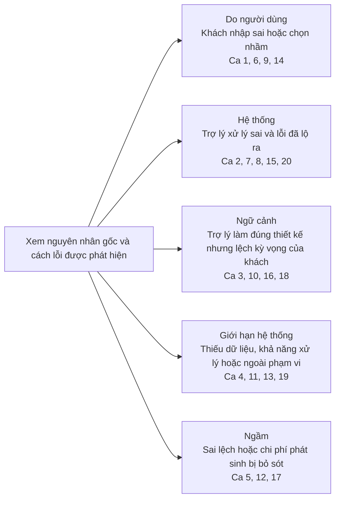

# Bảng lỗi và cách khắc phục · Nhiệm vụ C

20 ca lỗi nằm trong `docs/Ngay13_Lab13_De_bai_hoc_vien.docx`. Năm loại theo Google PAIR: **Do người dùng · Hệ thống · Ngữ cảnh · Giới hạn hệ thống · Ngầm**. Gắn nhãn theo nguyên nhân gốc, không theo chỗ cần sửa.

## Bảng nhãn TV4 và TV5

Cột TV4 ghi bộ nhãn do Codex chốt có tham chiếu [hướng dẫn Lab](../../docs/Lab13_Huong_dan_chi_tiet_buoi_chieu.md#nhãn-tham-khảo-cho-20-ca). Cột TV5 ghi bộ nhãn do TV5 báo cáo. Tỷ lệ dưới đây đo mức trùng của hai cột.

| Ca | Nhãn TV4 (Labeler 1) | Vì sao TV4 chọn nhãn này | Nhãn TV5 (Labeler 2) | Trùng? | Nhãn thống nhất |
| --: | --- | --- | --- | :---: | --- |
| 1 | Do người dùng | Số tài khoản khách nhập thiếu 2 chữ số, khiến ngân hàng từ chối lệnh hoàn. | Do người dùng | Có | Do người dùng |
| 2 | Hệ thống | Kiện 28 kg bị tra theo bảng giá hàng thường, khiến khách nhận thiếu 45.000 đ. | Hệ thống | Có | Hệ thống |
| 3 | Ngữ cảnh | Tiền về ví LogiX đúng thiết kế. Khách kỳ vọng tiền về tài khoản ngân hàng. | Ngữ cảnh | Có | Ngữ cảnh |
| 4 | Giới hạn hệ thống | LogiX thiếu dữ liệu chặng do hãng nước ngoài giao, nên trợ lý không xác định được trạng thái. | Giới hạn hệ thống | Có | Giới hạn hệ thống |
| 5 | Ngầm | Kiểm tra mẫu cuối tuần mới phát hiện 14 đơn được hoàn theo giá trước giảm (không ai báo lỗi trước đó). | Ngầm | Có | Ngầm |
| 6 | Do người dùng | Khách tự chọn luồng giao trễ cho một kiện hàng bị vỡ thay vì chọn luồng hư hại hàng hóa. | Ngữ cảnh | Không | Do người dùng |
| 7 | Hệ thống | Trợ lý báo hoàn thành công dù sổ cái trả lỗi 503 và chưa xác nhận giao dịch. | Hệ thống | Có | Hệ thống |
| 8 | Hệ thống | Trợ lý viện dẫn điều 7.2 trong câu trả lời dù chính sách hiện hành không có điều này. | Giới hạn hệ thống | Không | Hệ thống |
| 9 | Do người dùng | Khách nhập mã đơn của sàn thương mại điện tử vào ô yêu cầu mã vận đơn LogiX. | Do người dùng | Có | Do người dùng |
| 10 | Ngữ cảnh | Trợ lý áp dụng đúng điều khoản bất khả kháng khi có bão, nhưng cam kết giao trong 24 giờ trên ứng dụng tạo kỳ vọng khác cho khách. | Ngữ cảnh | Có | Ngữ cảnh |
| 11 | Giới hạn hệ thống | Trợ lý chưa hỗ trợ xử lý tin nhắn thoại, nên yêu cầu khách chuyển sang nhập bằng chữ. | Giới hạn hệ thống | Có | Giới hạn hệ thống |
| 12 | Ngầm | Kết quả vẫn đúng dù phải gọi tool nhiều lần. Tiền token ở depot D05 gấp 3 lần trong 3 tuần mà không ai nhận ra. | Ngầm | Có | Ngầm |
| 13 | Giới hạn hệ thống | Hoàn phí bảo hiểm của đối tác thứ ba nằm ngoài phạm vi thẩm quyền và dữ liệu của trợ lý. | Giới hạn hệ thống | Có | Giới hạn hệ thống |
| 14 | Do người dùng | Khách bấm nhầm xác nhận đã nhận tiền, khiến yêu cầu bị đóng tự động. | Do người dùng | Có | Do người dùng |
| 15 | Hệ thống | Trợ lý tính hoàn 100% thay vì 50% theo chính sách; nhân viên phát hiện và sửa trước khi gửi. | Hệ thống | Có | Hệ thống |
| 16 | Ngữ cảnh | Trợ lý gửi tin nhắn thông báo ngay khi xử lý xong theo thiết kế, nhưng thời điểm gửi 2:14 sáng gây phiền toái cho khách. | Ngữ cảnh | Có | Ngữ cảnh |
| 17 | Ngầm | Bảng giá cũ áp dụng ngầm gây chênh lệch 1.000–2.000 đ trên 212 đơn suốt 9 ngày mà không có khách nào khiếu nại hay mở lại. | Ngầm | Có | Ngầm |
| 18 | Ngữ cảnh | Mức hoàn 15.000 đ đúng chính sách nhưng tin nhắn không giải thích cách tính, khiến khách tưởng hoàn thiếu. | Ngữ cảnh | Có | Ngữ cảnh |
| 19 | Giới hạn hệ thống | Đơn hàng từ 14 tháng trước vượt quá phạm vi lưu trữ dữ liệu 12 tháng của trợ lý. | Giới hạn hệ thống | Có | Giới hạn hệ thống |
| 20 | Hệ thống | Lệnh thứ hai thiếu khóa chống trùng (`idempotency_key`), khiến cùng một khoản tiền bị hoàn hai lần. | Hệ thống | Có | Hệ thống |

**Tỷ lệ trùng nhãn:** 18/20 ca = **90,0%**. Rubric CP3 yêu cầu 2 bộ nhãn độc lập để áp dụng ngưỡng đồng thuận 80%.

**Quy tắc thống nhất cho 2 ca lệch:**
- **Ca 6 (Khách chọn luồng giao trễ cho kiện hàng bị vỡ):** Ban đầu TV5 xếp vào *Ngữ cảnh* vì cho rằng giao diện điều hướng gây hiểu nhầm ngữ cảnh khiếu nại. Tuy nhiên, sau khi thảo luận theo nguyên tắc xác định nguyên nhân gốc (root cause), nguyên nhân trực tiếp phát sinh lỗi là do khách hàng chủ động chọn sai phân loại lý do khi gửi form, do đó thống nhất là **Do người dùng**.
- **Ca 8 (Trợ lý viện dẫn điều 7.2 không tồn tại trong chính sách):** Ban đầu TV5 xếp vào *Giới hạn hệ thống* (do mô hình hallucination vượt ngoài vùng tri thức). Tuy nhiên, lỗi này đã biểu hiện lộ ra rõ ràng trong câu trả lời văn bản gửi cho người dùng và vi phạm trực tiếp tính chính xác của chính sách vận hành của hệ thống, nên thống nhất phân loại là lỗi **Hệ thống**.

## Sơ đồ phân loại của TV4

**Phân bố 20 ca sau thống nhất:** 4 lỗi Do người dùng (20%), 5 lỗi Hệ thống (25%), 4 lỗi Ngữ cảnh (20%), 4 lỗi Giới hạn hệ thống (20%), 3 lỗi Ngầm (15%).

## Bảng khắc phục cho 5 ca đại diện đủ 5 loại lỗi

Mỗi biện pháp khắc phục đều gắn với một event cụ thể có trường `trace_id` để truy vết, xác định ngưỡng phát hiện tự động đo được và phân công một vai trò cụ thể chịu trách nhiệm:

|  Ca | Loại lỗi          | Phát hiện bằng gì (Event & Ngưỡng đo lường) | Khắc phục thế nào | Ai phụ trách |
| --: | ----------------- | ------------------------------------------- | ----------------- | ------------ |
|   1 | Do người dùng     | Kiểm tra định dạng tài khoản trước mỗi lệnh hoàn. Ghi event `refund_account_validation_failed` và chặn lệnh ngay khi có $\ge 1$ lỗi định dạng theo quy chuẩn ngân hàng. | Hiển thị thông báo hướng dẫn định dạng chuẩn trên giao diện để khách sửa kịp thời. Chỉ kích hoạt gửi lệnh khi thông tin tài khoản hợp lệ. | Kỹ sư phụ trách tích hợp thanh toán |
|  20 | Hệ thống          | Theo dõi event `refund_ledger_write` theo thời gian thực. Cảnh báo khẩn cấp khi cùng một mã khoản hoàn xuất hiện $\ge 2$ giao dịch ghi nhận thành công. | Sử dụng khóa chống trùng cố định (`idempotency_key`) cho mỗi khoản hoàn và thiết lập ràng buộc duy nhất tại sổ cái kế toán. Tự động đối soát và thu hồi ngay khi có cảnh báo. | Kỹ sư trưởng agent |
|   3 | Ngữ cảnh          | Trước khi thực hiện lệnh, so sánh phương thức khách mong muốn với nơi trợ lý dự kiến hoàn. Ghi event `refund_destination_mismatch` và hiển thị cảnh báo ngay khi phát hiện lệch. | Hiển thị rõ ràng nơi nhận tiền (ví LogiX), thời gian tiền vào và cách dùng số dư trên giao diện. Bắt buộc khách bấm xác nhận đồng ý trước khi gửi lệnh. | Trưởng nhóm CSKH |
|   4 | Giới hạn hệ thống | Kiểm tra tính đầy đủ của dữ liệu vận đơn khi tiếp nhận. Nếu thiếu $\ge 1$ chặng do đối tác quốc tế giao, ghi event `handoff_to_staff` với lý do `missing_carrier_leg_data`. | Nêu rõ chặng chưa tra cứu được và tự động chuyển yêu cầu kèm mã vận đơn, tóm tắt ngữ cảnh cho nhân viên xử lý thủ công. | Trưởng nhóm CSKH |
|   5 | Ngầm              | Hằng tuần kiểm tra mẫu ngẫu nhiên các đơn có áp dụng voucher/mã giảm giá qua event `audit_sample_checked`. Tự động kích hoạt điều tra nếu phát hiện $\ge 1$ đơn hoàn tiền thừa. | Cập nhật logic tính tiền hoàn căn cứ trên số tiền thực trả sau khi đã trừ giá trị giảm giá. Thực hiện đối soát toàn bộ các khoản đã hoàn sai trên hệ thống. | Kế toán trưởng |
